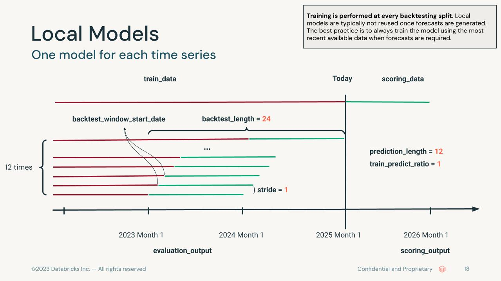
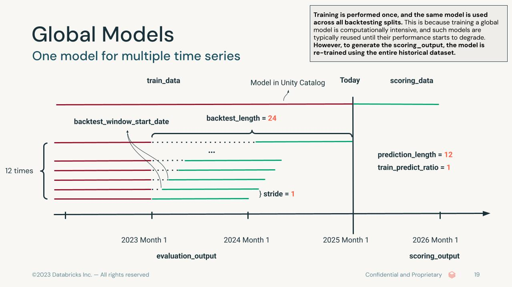

# Many-Model Forecasting Architecture

## Overview

The **MMF** (Many-Model Forecasting) is a comprehensive time series forecasting framework that enables evaluation and deployment of multiple forecasting models across many time series. The framework is designed to handle various types of models (local, global, and foundation models) and provides unified APIs for training, evaluation, and scoring.

## Entry Point: `run_forecast` Function

The primary entry point to the MMF is the `run_forecast` function located in `mmf_sa/__init__.py`. This function serves as the main orchestrator that:

1. **Configuration Management**: Handles configuration merging from multiple sources
2. **Forecaster Instantiation**: Creates and configures the `Forecaster` object
3. **Execution Control**: Triggers the evaluation and scoring pipeline

### Function Signature and Parameters

```python
def run_forecast(
    spark: SparkSession,
    train_data: Union[str, pd.DataFrame, DataFrame],
    scoring_data: Union[str, pd.DataFrame, DataFrame] = None,
    evaluation_output: str = None,
    scoring_output: str = None,
    group_id: str,
    date_col: str,
    target: str,
    freq: str,
    prediction_length: int,
    backtest_length: int,
    stride: int,
    metric: str = "smape",
    use_case_name: str = None,
    static_features: List[str] = None,
    dynamic_future_numerical: List[str] = None,
    dynamic_future_categorical: List[str] = None,
    dynamic_historical_numerical: List[str] = None,
    dynamic_historical_categorical: List[str] = None,
    active_models: List[str] = None,
    accelerator: str = "cpu",
    num_nodes: int = 1,
    train_predict_ratio: int = None,
    data_quality_check: bool = False,
    resample: bool = False,
    experiment_path: str = None,
    run_id: str = None,
    conf: Union[str, Dict[str, Any], OmegaConf] = None,
    prediction_intervals: Dict[str, Any] = None,
) -> str:
```

### Configuration Hierarchy

The system uses a hierarchical configuration approach. The latter steps override the former steps:

```
Base Configuration (e.g., forecasting_conf_daily.yaml)
    ↓
User Configuration (conf parameter)
    ↓
Function Parameters (direct arguments)
```

## Core Architecture: The Forecaster Class

The `Forecaster` class (`mmf_sa/Forecaster.py`) is the central orchestrator that manages the entire forecasting pipeline.

## Main Execution Flow: `evaluate_score` Method

The `evaluate_score` method is the main method of the `Forecaster` class. It runs data quality checks, performs backtesting (evaluation) for all models in the `active_models` list, and executes forecasting (scoring) for all models in the `active_models` list.

```python
def evaluate_score(self, evaluate: bool = True, score: bool = True) -> str:

    # 1. Data Quality Checks
    print("Run quality checks")
    src_df = self.resolve_source("train_data")
    clean_df, removed = DataQualityChecks(src_df, self.conf, self.spark).run(verbose=True)
    
    # 2. Evaluation
    if evaluate:
        self.evaluate_models()
    
    # 3. Scoring
    if score:
        self.score_models()
    
    return self.run_id
```

## Data Quality Management

### DataQualityChecks Class Architecture

The `DataQualityChecks` class (`mmf_sa/data_quality_checks.py`) provides comprehensive data validation. Checks consistes of mandatory and optional ones. See `mmf_sa/data_quality_checks.py` for details.

#### Key Features:
1. **External Regressor Validation**: Validates that resampling is disabled when external regressors are provided (mandatory)
2. **Training Period Validation**: Ensures that backtest_length contains at least one prediction_length (mandatory)
3. **Missing Data Detection**: Identifies and handles missing values (optional)
4. **Negative Value Validation**: Detects negative target values (optional)


## Model Management System

### Model Registry Architecture

The `ModelRegistry` class manages the lifecycle of forecasting models:

#### Model Configuration Structure:
```yaml
models:
  ModelName:
    module: path.to.model.module
    model_class: ModelClassName
    framework: StatsForecast|NeuralForecast|SKTime|Chronos|Moirai(disabled)|TimesFM
    model_type: local|global|foundation
    model_spec:
      parameter1: value1
      parameter2: value2
```

#### Model Type Classifications:

1. **Local Models**: 
   - Trained independently for each time series
   - Examples: StatsForecastAutoArima, StatsForecastAutoETS, SKTimeProphet
   - Processed using Pandas UDF for parallel execution

2. **Global Models**:
   - Trained on all time series simultaneously
   - Examples: NeuralForecastAutoNBEATSx, NeuralForecastAutoTiDE
   - Centralized training with shared parameters
   - Supports distributed training on single-node multi-GPU and multi-node multi-GPU clusters via `TorchDistributor`

3. **Foundation Models**:
   - Pre-trained models adapted for specific tasks
   - Examples: ChronosBoltBase, TimesFM_2_5_200m
   - Zero-shot learning capabilities

### Abstract Model Interface

All models inherit from `ForecastingRegressor` in `mmf_sa/models/abstract_model.py` which provides:

```python
class ForecastingRegressor(BaseEstimator, RegressorMixin):
    @abstractmethod
    def prepare_data(self, df: pd.DataFrame) -> pd.DataFrame
    
    @abstractmethod
    def fit(self, x, y=None)
    
    @abstractmethod
    def predict(self, x, y=None)
    
    @abstractmethod
    def forecast(self, x, spark=None)
    
    def backtest(self, df: pd.DataFrame, start: pd.Timestamp, ...) -> pd.DataFrame
    
    def calculate_metrics(self, hist_df: pd.DataFrame, val_df: pd.DataFrame, ...) -> Dict
```

## Evaluation Pipeline

### Model Evaluation Workflow

The `evaluate_models` method orchestrates model evaluation across different model types:

```python
def evaluate_models(self):
    for model_name in self.model_registry.get_active_model_keys():
        model_conf = self.model_registry.get_model_conf(model_name)
        if model_conf["model_type"] == "local":
            self.evaluate_local_model(model_conf)
        elif model_conf["model_type"] == "global":
            self.evaluate_global_model(model_conf)
        elif model_conf["model_type"] == "foundation":
            self.evaluate_foundation_model(model_conf)
```

### Local Model Evaluation

Local models are evaluated using Spark's `applyInPandas` for distributed processing:

1. **Data Preparation**: Resolves data sources and applies quality checks
2. **Parallel Processing**: Applies `evaluate_one_local_model` and performs backtesting for each group
3. **Results Aggregation**: Combines results from all time series and writes to the `evaluation_output` table
4. **MLflow Logging**: Records metrics per model aggregated over all time series

#### Backtest Process for Local Models:
```
Historical Data → Split by Group (Parallelization) → Split by Backtesting Start Date → Fit Model → Generate Forecasts → Calculate Metrics → Store Results
```

### Global Model Evaluation

Global models follow a two-phase training approach:

1. **Phase 1 - Final Model Training**:
   - Trains on complete dataset (train + validation)
   - Creates model artifacts
   - Registers model in Unity Catalog
   
2. **Phase 2 - Evaluation Training**:
   - Trains only on training data: i.e., all data excluding the `backtest_length`
   - Performs detailed backtesting using the same model
   - Calculates performance metrics and writes the results to the `evaluation_output` table

#### Multi-GPU Distributed Training

When `accelerator="gpu"` is set and the cluster has multiple GPUs (either on a single node or across multiple nodes), global models automatically use Spark's `TorchDistributor` with PyTorch DDP for distributed training. This is controlled by the `num_nodes` parameter:

- **Single-node multi-GPU** (`num_nodes=1`, default): All GPUs on the driver node participate in DDP training. Training data is partitioned to local storage (`/tmp/`).
- **Multi-node multi-GPU** (`num_nodes > 1`): GPUs across worker nodes participate in DDP training. Training data is partitioned to shared storage (`/dbfs/tmp/`) via the DBFS FUSE mount so all nodes can access it. Set `num_nodes` to the number of **worker** nodes. Autoscaling must be disabled to prevent workers from being removed mid-training.

If only a single GPU is available on a single-node cluster, training falls back to standard single-GPU mode without DDP.

### Foundation Model Evaluation

Foundation models leverage pre-trained weights:

1. **Model Loading**: Loads pre-trained foundation model
2. **Adaptation**: Applies model to specific time series format
3. **Evaluation**: Performs inference-based evaluation and writes the results to the `evaluation_output` table
4. **Registration**: Registers adapted model for deployment

## Backtesting Framework

### Backtesting Algorithm

The `backtest` method in `ForecastingRegressor` implements extending window validation:

```python
def backtest(self, df: pd.DataFrame, start: pd.Timestamp, ...) -> pd.DataFrame:
    # Initialize sliding window
    curr_date = start + self.one_ts_offset
    
    # Walk forward through time
    while curr_date + self.prediction_length_offset <= end_date:
        # Create training window
        train_df = df[df[date_col] < curr_date]
        
        # Create validation window
        val_df = df[(df[date_col] >= curr_date) & 
                   (df[date_col] < curr_date + prediction_length_offset)]
        
        # Calculate metrics
        metrics = self.calculate_metrics(train_df, val_df, curr_date)
        
        # Move to next window
        curr_date += stride_offset
```

### Metric Calculation

The system supports multiple out-of-the-box evaluation metrics:
- **SMAPE**: Symmetric Mean Absolute Percentage Error
- **MAPE**: Mean Absolute Percentage Error
- **MAE**: Mean Absolute Error
- **MSE**: Mean Squared Error
- **RMSE**: Root Mean Squared Error

### How Backtesting Works

Backtesting uses an **expanding window** strategy to evaluate model performance across multiple historical points. Three parameters control this process:

| Parameter | Description |
|---|---|
| `backtest_length` | Number of time steps (from the end of `train_data`) reserved for backtesting. This defines the evaluation region. |
| `prediction_length` | The forecast horizon — how many steps ahead the model predicts at each backtest window. |
| `stride` | How many time steps the window advances between consecutive backtests. A stride of 1 produces the maximum number of windows; larger strides reduce computation. |

The number of backtest windows is approximately:

```
num_windows = (backtest_length - prediction_length) / stride + 1
```

For example, with `backtest_length=24`, `prediction_length=12`, and `stride=1`, the framework produces **12** backtest windows.

An optional `train_predict_ratio` parameter (default 1) sets the minimum ratio of training data points to `prediction_length`. During data quality checks, any time series with fewer training points than `train_predict_ratio × prediction_length` is excluded.

### Backtesting by Model Type

The backtesting mechanism differs depending on the model type:

#### Local Models

Local models are trained independently for each time series. During backtesting, **the model is re-trained at every backtest split** — each window gets its own freshly fitted model. This matches the typical local-model workflow where you always retrain on the most recent available data before producing a forecast.



#### Global Models

Global models are trained once on all time series simultaneously (excluding the `backtest_length` region), and **the same trained model is reused across all backtest splits**. This is because training a global model is computationally intensive. For scoring, a separate final model is re-trained on the entire historical dataset and registered in Unity Catalog (only logged to the MLflow experiment with `register_models=False`). Both the final model and the backtest model are logged to the MLflow run.


#### Foundation Models

Foundation models are pre-trained or fine-tuned, so **there is no training involved during evaluation or scoring — only inference**. The backtest windows are evaluated by running the foundation model's predict method on each split. The model is registered in Unity Catalog for scoring (only logged to the MLflow experiment with `register_models=False`).



## Scoring Pipeline

### Scoring Workflow

The scoring pipeline generates forecasts:

1. **Model Retrieval**: Loads trained models from MLflow registry (only for global and foundation models)
2. **Data Preparation**: Prepares scoring data with quality checks
3. **Prediction Generation**: Generates forecasts using trained models
4. **Result Storage**: Saves predictions to specified output (`scoring_output`) tables

### Scoring Methods by Model Type

#### Local Model Scoring:
- Uses Pandas UDF for parallel processing
- Generates predictions per time series group
- Saves serialized model artifacts in a Delta table for reproducibility and auditability

#### Global Model Scoring:
- Loads centralized model from MLflow
- Applies model to entire scoring dataset
- Generates predictions for all time series and writes to `scoring_output` tables

#### Foundation Model Scoring:
- Loads pre-trained foundation model
- Applies zero-shot inference
- Generates predictions without additional training and writes to `scoring_output` tables

## Data Flow Architecture

### Data Resolution System

The `resolve_source` method provides flexible data source handling:

```python
def resolve_source(self, key: str) -> DataFrame:
    # Check if data is in data_conf (direct data objects)
    if self.data_conf and key in self.data_conf:
        data = self.data_conf[key]
        if isinstance(data, pd.DataFrame):
            return self.spark.createDataFrame(data)
        elif isinstance(data, DataFrame):
            return data
    
    # Otherwise, read from table name in configuration
    return self.spark.read.table(self.conf[key])
```

### Data Preparation Pipeline

1. **Source Resolution**: Determines data source type (table, DataFrame, etc.)
2. **Quality Checks**: Applies comprehensive data validation
3. **Format Standardization**: Converts to required format for models
4. **Feature Engineering**: Processes external regressors and features

## Prediction Intervals

MMF produces prediction intervals in two optional steps:

1. **The models' own intervals, from `run_forecast`.** With `prediction_intervals={"enabled": True}` (off by default), the models that can return quantiles (statsforecast, Chronos, TimesFM, Moirai, `SKTimeProphet` and the `FF*` models) return them in every backtest window and at scoring. MMF writes them as the models return them: `forecast_quantiles` in `evaluation_output`, and the interval columns in `scoring_output`. The other models get NULL intervals. The subsections below, up to [Calibrated intervals](#calibrated-intervals-calibrate_intervals), describe this step.
2. **Calibrated intervals, from `calibrate_intervals`.** A separate function, run after the forecasts on CPU, reads those tables, corrects the models' intervals so that they reach the requested coverage, and builds intervals for the models that have none. It writes its own tables and never modifies the forecast tables. See [Calibrated intervals](#calibrated-intervals-calibrate_intervals).

This section describes the code. The user-facing description is in the [main README](../README.md#prediction-intervals).

### Modules

| Module | Role |
|---|---|
| `mmf_sa/intervals/config.py` | Pure Python. The `prediction_intervals` configuration (defaults, validation) and the level helpers. |
| `mmf_sa/intervals/quantiles.py` | The contract the models use: quantile keys and column names, the packing of the Spark UDF output, and the quantile maps written to the tables (`sorted_quantiles`: non-finite keys dropped, values sorted per step). |
| `mmf_sa/intervals/scoring.py` | The interval columns of `scoring_output`, built from each forecast's quantile map with Spark column expressions (no Python UDF). |
| `Forecaster.native_quantiles`, `get_model_with_native_quantiles` | Which models are asked for quantiles: those flagged `native_intervals` in `models_conf.yaml`. The others are logged once and get NULL interval columns. |
| `Forecaster.write_scoring_output` | Replaces the quantile map of a model's forecasts with the interval columns of `output_format`, and appends to `scoring_output`. |

### Data flow

```
evaluate_models   models flagged native_intervals get native_quantiles; their backtest writes
                  forecast_quantiles (MAP<STRING, ARRAY<DOUBLE>>, sorted per step) to evaluation_output;
                  other models write NULL
score_models      the same quantiles at forecast time -> <target>_quantiles and/or <target>_lo_<L> /
                  <target>_hi_<L> in scoring_output (output_format); NULL where a quantile is missing
```

### The output contract

- Map keys are `quantile_key(q)`: no trailing zeros, e.g. `"0.1"`, `"0.025"`, `"0.975"`. The median `"0.5"` is always included for models with native intervals.
- Each value is an array over the horizon, aligned with `forecast` (evaluation) or `<target>` (scoring).
- Level `L` maps to the quantiles `(100 - L) / 200` and `1 - (100 - L) / 200`; in column names, `80` gives `_80` and `97.5` gives `_97_5`.
- A level's two bounds are both NULL when the model did not return both of its quantiles.

### Adding native intervals to a model

1. Set `native_intervals: true` for the model in `models_conf.yaml`, and `native_quantiles_supported = True` on its class (a unit test checks that both agree). If the model only predicts some quantile levels, set `native_quantile_range = (min, max)`; if its quantiles come from sample paths, set `samples_hparam` to the hyperparameter holding their number.
2. When `self.params.native_quantiles` is set, make `predict` (backtest) and `forecast` (scoring) return one column per level of `self.native_levels()`, named with `QUANTILE_COLUMN_PREFIX + quantile_key(q)` from `mmf_sa/intervals/quantiles.py` (e.g. `__q_0.975`), next to the point forecast. `native_levels()` sorts the levels, adds the median, leaves out the levels outside `native_quantile_range`, and logs once about them and about fewer than 100 sample paths; call it on the driver, so that the warnings reach the driver log. A model whose range is only known at prediction time (Chronos) returns NaN for the levels outside it. `ForecastingRegressor.forecast_quantiles` (local models) and `ForecastingRegressor.series_metrics` (global and foundation models) turn the columns into the `forecast_quantiles` map.
3. Requesting quantiles must not change the point forecast.

### Calibrated intervals (`calibrate_intervals`)

The native bands above are the models' own, and their coverage can be far from nominal (Chronos-Bolt's 95% band does
not exist; on M5, AutoETS's 80% band covers 87-88% and SeasonalNaive's 91%). `mmf_sa.calibrate_intervals` calibrates them, and builds
intervals for the models that have none. It reads only the tables that `run_forecast` writes, and runs as its own job
on CPU compute after the forecast jobs (Skill 4's orchestrating job), so the GPU jobs only forecast and recalibrating
never reruns the models.

```python
from mmf_sa import calibrate_intervals

calibrate_intervals(spark, train_data="cat.sch.uc_train_data", evaluation_output="cat.sch.uc_evaluation_output",
                    scoring_output="cat.sch.uc_scoring_output", freq="D",
                    settings={"levels": [80, 95], "output_format": "both"})
```

#### Modules

| Module | Role |
|---|---|
| `mmf_sa/intervals/calibrator.py` | `calibrate_intervals` and `IntervalCalibrator`: run selection, reading the tables, the split of levels between CQR and conformal, writing the three output tables. |
| `mmf_sa/intervals/conformal.py` | Pure numpy. The reference implementation (`calibrate_model`): scores, pools, conformal quantiles, CQR corrections, bounds and metrics. |
| `mmf_sa/intervals/spark.py` | The same calibration distributed: exact pooled order statistics in Spark, the per-series combination in `applyInPandas`. Tests check it against `conformal.calibrate_model`. |
| `mmf_sa/intervals/features.py` | Per-series scale and classes (ABC, XYZ, Syntetos-Boylan), group labels, backtest cubes. |
| `mmf_sa/intervals/calibration_config.py` | The calibration settings, their defaults and validation. |
| `mmf_sa/intervals/calibration_scoring.py` | Applying the corrections to the forecasts (clipping, nesting), and the output rows. |

#### Data flow

```
latest_runs        each model's latest run in evaluation_output (or models / run_ids)
features           per series, from train_data before its first backtest window: sigma (in-sample seasonal-naive
                   MAE), ABC, XYZ and Syntetos-Boylan classes
per model          the levels with native quantiles in every backtest row -> CQR; the other levels (and models
                   without native intervals) -> conformal
                   corrections fitted on all W windows -> <prefix>_evaluation_output_calibration
                   each window scored with corrections fitted on the other W - 1 -> _interval_metrics
scoring            corrections applied to the forecasts of scoring_output (their native map for CQR)
                   -> <prefix>_scoring_output_intervals
```

#### Scale

Every score is divided by a per-series scale sigma_i, the in-sample mean absolute error of the seasonal-naive
forecast (season 24, 7, 52 or 12 for hourly, daily, weekly or monthly data) over the history before the series' first
backtest window. Series with a zero scale (e.g. all zeros) use the median scale of the others. Scores of different
series are then comparable, and can be pooled.

#### Conformal intervals (models without native intervals)

- **Scores.** e = (y - yhat) / sigma_i for every series, backtest window and horizon step (`score: signed_normalized`;
  `signed` does not divide by sigma).
- **Pooled quantiles.** The lower and upper bounds use the alpha/2 and 1 - alpha/2 conformal quantiles of the scores of
  a pool, per horizon step: the k-th smallest of n scores with k = ceil((n + 1) q) (the split-conformal rank, which
  guarantees coverage of at least q on exchangeable data). A rank beyond n is clipped to the largest score and flagged
  `infinite_bound`.
- **Per-series shrinkage (the default, `coverage.target: series`).** Each series' own quantiles are computed from its
  scores and shrunk toward the pool's: q_i = lambda q_series + (1 - lambda) q_pool, lambda = W / (W + kappa) with
  kappa = 10 (`coverage.shrinkage_kappa`), so with 3 windows a series gets 23% weight. With fewer windows than the widest
  level needs for a finite rank per step (`windows_for_finite_bounds`: 9 at 80%, 39 at 95%), a series' quantiles are
  computed over all its W x H scores and the pool's step profile is applied as a ratio (`coverage.pool_horizon: auto`).
- **Bounds.** yhat + sigma_i q_lo and yhat + sigma_i q_hi.
- **Other targets.** `marginal` and `group` use the pool's quantiles without per-series shrinkage. `series_scale`
  shrinks a scale estimate of each series instead of its tail quantiles: scores are divided by
  c_i = (n_i d_i + kappa d_pool) / ((n_i + kappa) d_pool), d being the mean |e| over the series' n_i = W x H scores and
  over the pool, before the pool's quantiles are taken; the bounds are yhat + sigma_i c_i q.

#### CQR (models with native intervals)

Conformalized quantile regression (Romano et al., 2019) keeps the native band's shape and corrects its width from its
misses on the backtest:

- **Scores (`cqr_score: asymmetric`, the default).** One per tail: s_lo = (lo - y) / sigma_i and s_hi = (y - hi) /
  sigma_i, positive when the actual falls outside the band.
- **Tail split (`cqr_tail_split: adaptive`).** The lower correction is the 1 - alpha/2 conformal quantile of s_lo. The
  upper one uses the level 1 - alpha + m_lo (at most 1 - alpha/2), where m_lo is the lower tail's realised miss rate
  after correction: for non-negative series whose lower bound is clipped at 0, the lower tail rarely misses, and the
  unused share goes to the upper tail. `equal` gives each tail alpha/2.
- **Bounds.** lo - sigma_i q_lo and hi + sigma_i q_hi. A negative correction narrows a band that over-covers.
- **Pool (`cqr_pool: marginal`).** The corrections are pooled over all series, per horizon step, with no per-series
  shrinkage. `group` pools per `group_col`; `series` shrinks each series' corrections toward its pool, with the weight
  of the conformal tails above.
- **Other scores.** `symmetric` uses one score max(lo - y, y - hi) / sigma_i; `scaled` divides |y - yhat| by the native
  half-width, so the correction is a factor of the band.
- **Native quantiles at scoring.** The corrections are applied to the forecast's own native band from scoring_output.
  A level the model has no native quantiles for (outside its native range, NULL in scoring_output) is calibrated with
  conformal intervals instead, at both calibration and scoring.

#### Clipping and nesting

Bounds are clipped at `clip_lower` (`auto`: 0 when the training target is never negative) and uncrossed. Levels are
calibrated separately, so scoring widens each wider level to contain the next narrower one (and the native median),
so that quantiles never cross; this only raises coverage. The interval metrics measure each level before this nesting.

#### Interval metrics

Written per series and backtest window, leave-one-window-out: window j is scored with corrections fitted on the other
W - 1 windows, so the metrics are out of sample (they need W >= 2).

| Metric | Meaning |
|---|---|
| `coverage_<L>` | Share of the window's actuals inside the interval |
| `miss_lo_<L>`, `miss_hi_<L>` | Shares below the lower and above the upper bound (`coverage + miss_lo + miss_hi = 1`) |
| `msis_<L>` | Interval score (width + 2/alpha x the misses' distances), scaled by sigma_i; lower is better at equal coverage |
| `width_<L>` | Mean width, scaled by sigma_i |
| `scaled_ae` | Mean absolute error of the point forecast, scaled by sigma_i |
| `wis` | Weighted interval score over all levels and the point forecast, a quantile-based approximation of CRPS |
| `native_*` | The same for the uncorrected native band |

#### Settings and defaults

`calibrate_intervals` takes the data and the tables as arguments (`train_data`, `evaluation_output`, `scoring_output`,
`group_id`, `date_col`, `target`, `freq`), plus `output_prefix`, `models`, `run_ids` and `use_case`. Everything about the
calibration goes in `settings`, the calibration block: the same keys as the `prediction_intervals` block of
`run_forecast`, with `enabled` implied.

| `settings` key | Default | Meaning |
|---|---|---|
| `levels` / `quantiles` | `[80, 95]` | The calibrated levels. `quantiles` (central pairs, e.g. `[0.1, 0.5, 0.9]`) replaces `levels` |
| `method` / `method_by_model` | `auto` | `auto`: CQR on native bands where available, conformal otherwise; or `conformal`, `native` (the band as is), `cqr`. `method_by_model` maps a model to its method |
| `pool` | `marginal` | `group` pools per `group_col`; `marginal` pools all series in one pool. Applies to the CQR corrections and the conformal scores |
| `group_col` | `None` | With `pool="group"`: a column of train_data, a list of columns, or `"auto"` for MMF's ABC x XYZ classes. Given without `pool="group"`, or `pool="group"` without it, is an error |
| `coverage.shrinkage_kappa` | `10` | Strength of the per-series shrinkage toward the pool (conformal tails; CQR corrections with `cqr_pool: series`) |
| `output_format` | `quantile_map` | Columns of `_scoring_output_intervals`: `quantile_map`, `lo_hi` or `both` |
| `cqr_pool` | `marginal` | The internal name of `pool`, which also accepts `series` (shrinks the CQR corrections toward the pool). Give `pool` or `cqr_pool`, not both |
| `coverage` | see `calibration_config` | Advanced: `target`, `group_col` (the internal name of `group_col`), `min_scores_per_group`, `pool_horizon`, `shrinkage_kappa` |
| `cqr_score`, `cqr_tail_split`, `score`, `clip_lower` | see `calibration_config` | Advanced options of the CQR scores, the tail split, the conformal score and the lower clipping |

`use_case` (an argument, not a setting) calibrates only the rows of one use case, when the forecast tables are shared by
several (the output tables have no use_case column: give each use case its own `output_prefix`).

The pooling keys are checked together in `calibration_config`: `pool="group"` needs `group_col`, and `group_col` needs
`pool="group"`. A setting given under both names is an error.

**Why these defaults.** On 2,000 series of M5 and of M4 monthly with 3 backtest windows and the last horizon held out
(`tests/validation/pi_calibration_coverage.py` and `pi_scale_candidates.py`, every model calibrated with conformal
intervals), the `series` target over one pool reached
0.76-0.80 held-out coverage at 80% and 0.93-0.95 at 95% for every model, within about half a point of ABC x XYZ pools,
while `series_scale` under-covered M4 monthly (0.70-0.73 and 0.84-0.86). ABC x XYZ pools (`pool="group",
group_col="auto"`) were then compared with one pool on 11 datasets (`tests/validation/POOLING_VALIDATION.md`, 3 samples
of series and 3 or 6 windows). On intermittent demand (M5, Car Parts, Online Retail) they lower the coverage gap of the
worst-covered decile of series scale by 1-27 points and WIS by 1-6%, mostly for models without native intervals, at
the same marginal coverage. They change little on smooth volumes (Hospital, London smart meters, Tourism, Electricity),
and lose 1-10 points of coverage on rates and prices (Traffic occupancy, EPF electricity prices). So one pool stays the
default, and ABC x XYZ is recommended for intermittent demand only.

#### Scaling

Nothing that grows with the number of series is collected to the driver. The pooled conformal quantiles are exact
order statistics computed with `row_number()` over (fold, pool, step), and the leave-one-window-out folds are computed
in one pass; the driver only receives pool statistics (pools x steps), the adaptive CQR miss rates and the per-level
fallback corrections. On serverless, where DataFrames cannot be cached, intermediate results are written to temporary
tables `<prefix>_pi_tmp_*`, dropped at the end. 1M series x 2 models took 7.8 minutes on 4 x i3.2xlarge
(`tests/validation/pi_scale_calibration.py`).

## Hierarchical Reconciliation

When time series form a hierarchy (e.g. store → region → country → total), independently produced forecasts at each level are usually **incoherent** — the store forecasts do not sum to the region forecast, which does not sum to the country forecast. Hierarchical reconciliation post-processes the base forecasts so they are **coherent** across all levels.

MMF generates base forecasts per level via independent pipeline runs (each producing a `best_models` and an `evaluation_output` table), then `run_reconciliation_multilevel` combines them using a user-provided membership table (a parent–child adjacency list) and writes a coherent `reconciliation_output` table.

Reconciliation is powered by Nixtla's [HierarchicalForecast](https://github.com/Nixtla/hierarchicalforecast) package ([documentation](https://nixtlaverse.nixtla.io/hierarchicalforecast/)). Install the optional dependency with `pip install mmf_sa[hierarchical]`.

```python
from mmf_sa import run_reconciliation_multilevel

run_reconciliation_multilevel(
    spark=spark,
    levels=[
        {"name": "store",   "best_models_table": "cat.sch.store_best_models",   "evaluation_table": "cat.sch.store_evaluation_output"},
        {"name": "region",  "best_models_table": "cat.sch.region_best_models",  "evaluation_table": "cat.sch.region_evaluation_output"},
        {"name": "country", "best_models_table": "cat.sch.country_best_models", "evaluation_table": "cat.sch.country_evaluation_output"},
    ],
    hierarchy_table="cat.sch.membership",   # columns: unique_id, level_name, parent_unique_id
    reconciliation_output="cat.sch.reconciliation_output",
    freq="D",                               # H | D | W | M
    method="MinTrace",                      # see methods below
    mintrace_method="mint_shrink",          # MinTrace sub-method
    middle_level=None,                      # required only when method="MiddleOut"
)
```

### Reconciliation methods

| Method | How it works | Needs backtest residuals? | Pros | Cons |
|--------|--------------|---------------------------|------|------|
| **BottomUp** | Sums leaf forecasts upward | No | Simple, robust, unbiased if leaf forecasts are; always coherent | Ignores information in aggregate-level forecasts; noise in leaves propagates upward; requires forecastable leaves |
| **TopDown** | Forecasts the top level and distributes it down by historical proportions | No | Stable when the top level is far more forecastable than sparse/noisy leaves | Discards leaf-level signal; assumes stable proportions; cannot capture differing per-leaf dynamics |
| **MiddleOut** | Anchors at a chosen middle level; BottomUp above it, TopDown below | No | Useful when an intermediate level is the most reliable | Must pick the right middle level; inherits BottomUp/TopDown limitations above/below |
| **MinTrace (`mint_shrink`)** | GLS reconciliation minimizing total forecast-error variance using a **shrinkage** estimate of the error covariance | Yes | Statistically optimal; uses information from all levels; covariance is well-conditioned even with limited residuals; recommended default | Needs backtest residuals; dense covariance build and inverse is `O(n³)` for large hierarchies; quality depends on enough residual samples |
| **MinTrace (`mint_cov`)** | MinT with the **full sample** covariance | Yes | Theoretically optimal when the covariance is well estimated | Requires many residual samples (`T ≫ n`); unstable/singular otherwise |
| **MinTrace (`wls_var`)** | MinT with **diagonal** weights = inverse per-series error variance | Yes | Cheap, stable, sparse-friendly; no full covariance | Ignores cross-series error correlations |
| **MinTrace (`wls_struct`)** | MinT with **structural** weights (number of bottom series under each node) | No | Scalable/sparse; needs no residuals | Ignores actual forecast errors |
| **ERM** | Learns a reconciliation matrix empirically from residuals | Yes | Data-driven; can outperform when ample history exists | Experimental; needs substantial backtest history; risk of overfitting |

**Choosing a method:** `MinTrace` with `mint_shrink` is the recommended default when backtests are available. For very large hierarchies or sparse upper levels (few residual samples), prefer `wls_struct`/`wls_var` (diagonal/structural — sparse and stable). `BottomUp` is a robust no-residual baseline. `TopDown`/`MiddleOut` suit cases where higher levels are more forecastable than the leaves.

> Reconciliation assumes **additive coherence** (a parent equals the sum of its children) and runs on classic compute (Single Node, DBR ML) — `toArrow()` and scipy sparse matrices are not available on serverless / Spark Connect.

## Integration Points

### MLflow Integration

The system integrates extensively with MLflow for:

1. **Experiment Tracking**: Logs all runs with parameters and metrics
2. **Model Registration**: Stores trained models in Unity Catalog
3. **Version Control**: Tracks model versions and lineage

### Spark Integration

Spark is used for:

1. **Data Processing**: Handles large-scale data operations
2. **Distributed Computing**: Parallel model training and evaluation
3. **Table Operations**: Reads from and writes to Delta tables

## Configuration Management

### Configuration Files

1. **`forecasting_conf_<frequency>.yaml`**: Base configuration with default settings
2. **`models/models_conf.yaml`**: Model definitions and specifications
3. **User Configuration**: Custom overrides and specific settings

## Error Handling and Logging

### Exception Hierarchy

The system defines custom exceptions for different error scenarios:

- `ConfigurationError`: Configuration validation issues
- `ModelError`: Model-specific errors
- `DataError`: Data quality and processing issues
- `EvaluationError`: Evaluation pipeline errors
- `ScoringError`: Scoring pipeline errors

### Advanced Configuration

```python
# Custom configuration
config = {
    "models": {
        "StatsForecastAutoArima": {
            "model_spec": {
                "season_length": 12,
                "approximation": False
            }
        }
    }
}

run_id = run_forecast(
    spark=spark,
    train_data=train_df,  # Pandas DataFrame
    scoring_data=score_df,
    scoring_output="output_table",
    group_id="series_id",
    date_col="timestamp",
    target="value",
    freq="M",
    prediction_length=6,
    backtest_length=12,
    stride=1,
    data_quality_check=True,
    resample=True,
    conf=config
)
```

## Extensibility

### Adding New Models

1. **Create Model Class**: Inherit from `ForecastingRegressor`
2. **Implement Required Methods**: `fit`, `predict`, `forecast`, `prepare_data`
3. **Add Configuration**: Update `models_conf.yaml`
4. **Activate**: Add to active models list

### Custom Metrics

1. **Implement Metric Function**: Create custom metric calculation
2. **Update Abstract Model**: Add metric to `calculate_metrics`
3. **Configuration Update**: Add metric to supported metrics list


## Best Practices

### Data Management
- Implement data quality checks prior to using MMF
- Address missing values and anomalies prior to using MMF
- Obtain sufficient history

### Configuration Management
- Use version control for configuration files
- Document configuration changes
- Test configurations in development environments

### Performance Optimization
- Monitor resource usage
- Optimize Spark configurations
- Use appropriate cluster sizes

This comprehensive architecture enables the MMF to handle complex forecasting scenarios while maintaining flexibility, scalability, and maintainability. 
